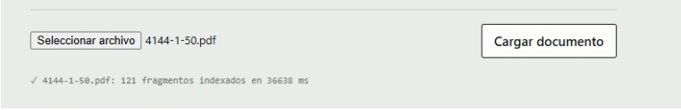
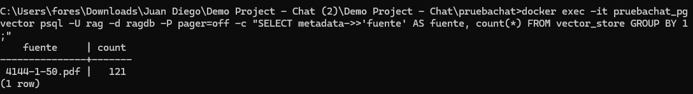
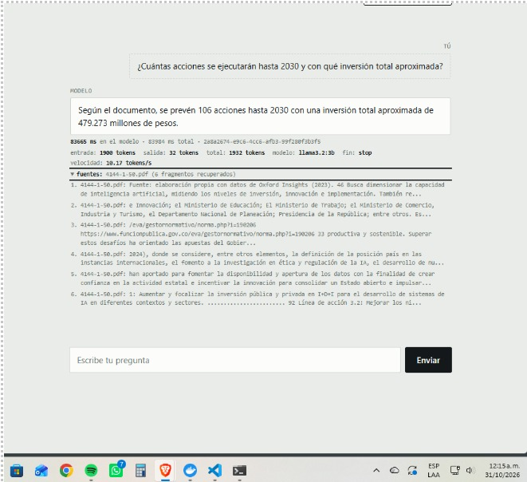
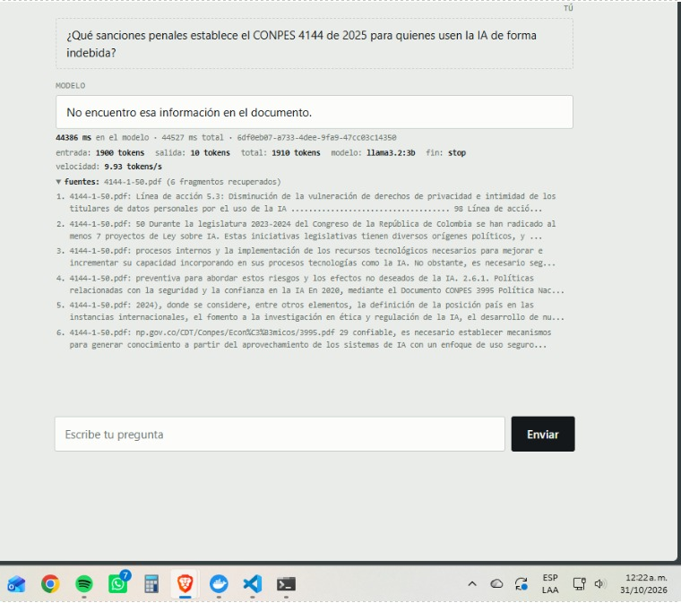
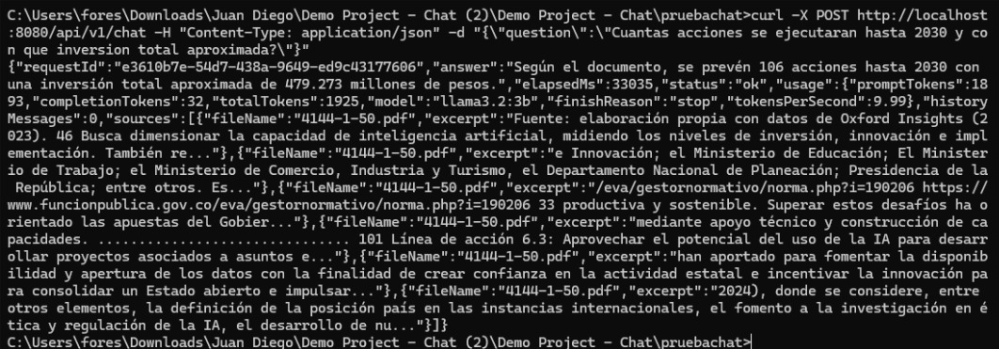

# Chat con documentos usando RAG (Spring AI + PGVector)

Taller del curso **Aplicaciones basadas en grandes modelos de lenguaje** (Módulo 2: RAG), Universidad El Bosque.
Partimos del proyecto base `pruebachat` (Spring Boot + Spring AI + Ollama + frontend web, todo con Docker Compose) y le agregamos RAG: ahora el usuario sube un documento desde el navegador y el chat responde con base en su contenido.

> Cómo leer este informe: las secciones siguen la estructura pedida en el taller. Las capturas están en `docs/capturas/`.

## Contenido

1. [Integrantes y documento seleccionado](#1-integrantes-y-documento-seleccionado)
2. [Arquitectura](#2-arquitectura-explicada-con-nuestras-palabras)
3. [Instrucciones de ejecución](#3-instrucciones-de-ejecución)
4. [Evidencias (sin RAG frente a con RAG)](#4-evidencias)
5. [Resultados de los Retos 1 a 3](#5-resultados-de-los-retos)
6. [Limitaciones observadas y mejora propuesta](#6-limitaciones-observadas-y-mejora-propuesta)

---

## 1. Integrantes y documento seleccionado

**Docente:** Andrés Felipe Rey Chaves

**Integrantes**

- Jeison Miguel Gómez Gómez
- Juan Diego Moreno Alayón
- Mariana Landínez Restrepo

**Documento seleccionado:** *Documento CONPES 4144 de 2025, Política Nacional de Inteligencia Artificial* (Consejo Nacional de Política Económica y Social, Departamento Nacional de Planeación, Colombia). Fue aprobado el 14 de febrero de 2025 y define la política pública de IA del país hacia 2030.

- **Páginas:** Se indexaron las primeras 50 páginas del documento para cumplir con el limite de entre 5 y 50 paginas. 
- **Por qué fue seleccionado:**
  - El modelo no tiene conocimiento acerca del documento, esto fue comprobado con el experimento base: sin RAG, llama3.2:3b respondió que no tiene información sobre el CONPES 4144, ya que su memoria tiene límite de alrededor de 2024.
  - Es un documento público del Estado colombiano, sin datos personales ni información confidencial.
  - Tiene cifras y datos concretos (106 acciones, 479.273 millones de pesos, 15 mesas técnicas) que permiten verificar facilmente si una respuesta es correcta.
- **Fuente:** https://ambitojuridico.com/sites/default/files/2025-02/Conpes-4144-2025.pdf 

---

## 2. Arquitectura explicada 
Un sistema RAG tiene dos flujos independientes, primero la ingesta, la cual se hace una vez por documento, y la consulta, que se hace en cada pregunta. El modelo de lenguaje no se aprende el documento, en cada pregunta recibe, dentro del prompt, solo los fragmentos más relevantes para poder responder la pregunta.


### Flujo de ingesta (cargar el archivo)

1. El usuario elige un archivo en el frontend la página  y presiona el boton de cargar documento. El navegador lo envía mediante a POST /api/v1/documents.
2. DocumentController recibe el archivo y se lo pasa a IngestionService.
3. Después TikaDocumentReader detecta el formato y extrae el texto plano.
4. TokenTextSplitter divide el texto en fragmentos llamados "chunks" de unos 300 tokens. A cada fragmento se le agrega el metadato fuente con el nombre del archivo.
5. vectorStore.add() hace dos cosas, primero llama al modelo de embeddings nomic-embed-text en Ollama, que convierte cada fragmento en un vector de que representa su significado, y guarda en PostgreSQL con la extensión de pgvector el texto, los metadatos y el vector, en la tabla vector_store.
6. El backend responde con el número de fragmentos indexados y el tiempo, y la página lo muestra.

### Flujo de consulta (de la pregunta a la respuesta)

1. El usuario escribe una pregunta y el frontend la envía a  con POST a /api/v1/chat junto con un sessionId.
2. ChatController llama a SpringAiModelService, que usa un ChatClient con el QuestionAnswerAdvisor. Un advisor intercepta la llamada, como un filtro web, y modifica el prompt antes de enviarlo al modelo.
3. El advisor calcula el embedding de la pregunta con el mismo modelo que se usó en la ingesta, para que pregunta y fragmentos queden en el mismo espacio vectorial.
4. Busca en PGVector los 6 fragmentos más cercanos, es decir (topK=6) y descarta los que tengan similitud menor a 0.5.
5. Arma el prompt con la  plantilla en español: la pregunta, los fragmentos como contexto y la instrucción de responder solo con ese contexto o decir "No encuentro esa información en el documento."
6. llama3.2:3b (en Ollama) genera la respuesta. La memoria de conversación del proyecto base (en RAM, por sesión) agrega el historial.
7. El backend devuelve la respuesta, las métricas de uso y las fuentes, es decir los fragmentos recuperados. El frontend muestra el texto y una línea desplegable con el archivo y un extracto de cada fragmento.

### Servicios de Docker Compose

| Servicio | Función |
|---|---|
| `ollama` | Servidor de modelos (chat y embeddings) |
| `ollama-pull` | Descarga `llama3.2:3b` una sola vez |
| `ollama-pull-embed` | Descarga `nomic-embed-text` una sola vez |
| `pgvector` | PostgreSQL 17 con la extensión pgvector (base `ragdb`) |
| `backend` | Spring Boot (puerto 8080): ingesta, chat y RAG |
| `frontend` | Página web (puerto 4200) con chat y botón de carga |


---

## 3. Instrucciones de ejecución

**Requisitos:** Docker Desktop en ejecución. La primera vez se descargan llama3.2:3b (~2 GB) y nomic-embed-text (~270 MB), así que puede tardar varios minutos.

```bash
# 1. Levantar todo (desde la raíz del proyecto)
docker compose -f docker/docker-compose.yml up -d --build

# 2. Comprobar los modelos (deben aparecer llama3.2:3b y nomic-embed-text)
docker exec -it pruebachat_ollama ollama list

# 3. Comprobar PostgreSQL con pgvector
docker exec -it pruebachat_pgvector psql -U rag -d ragdb -c "select version();"
```

Luego:

1. Abrir http://localhost:4200.
2. Elegir un PDF (texto seleccionable, sin datos personales) y presionar **Cargar documento**. Esperar el mensaje `✓ ... fragmentos indexados`.
3. Hacer preguntas en el chat. Bajo cada respuesta aparece la línea **fuentes** (desplegable).

**Comandos útiles**

```bash
# Ver cuántos fragmentos hay indexados, por archivo
docker exec -it pruebachat_pgvector psql -U rag -d ragdb -c "SELECT metadata->>'fuente' AS fuente, count(*) FROM vector_store GROUP BY 1;"

# Borrar los fragmentos (necesario antes de reindexar con otro tamaño de fragmento)
docker exec -it pruebachat_pgvector psql -U rag -d ragdb -c "TRUNCATE vector_store;"

# Ver el log del backend (incluye el prompt completo que recibe el modelo)
docker logs -f pruebachat_backend
```

**Configuración recomendada**: De acuerdo con los experimentos, la mejor configuración fue: fragmentos de 300 tokens IngestionService, topK=6 y umbral de similitud 0.5 , num-ctx=8192.

**Observaciones de uso:** cada recarga de la página  abre una conversación nueva, sin historial. Subir dos veces el mismo PDF duplica los fragmentos.

---

## 4. Evidencias

### Tabla del Paso 9: primera prueba (sin RAG frente a con RAG)

Primera prueba con el pipeline del taller tal cual: fragmentos de 500 tokens, `topK=4`, umbral 0.5 y **plantilla por defecto del advisor** (en inglés). Cada respuesta se comparó con la línea base sin RAG.

| # | Pregunta | Respuesta esperada (pág.) | Sin RAG | Con RAG | ¿Correcta? |
|---|---|---|---|---|---|
| 1 | Según el CONPES 4144 de 2025, ¿en qué fecha fue aprobado y cómo se llama la política? | 14 de febrero de 2025; Política Nacional de Inteligencia Artificial | "No tengo acceso a información específica sobre el CONPES 4144 de 2025… No tengo conocimiento sobre esta política" | "No tengo información sobre la fecha de aprobación… el CONPES 4144 es un documento que desarrolla políticas públicas relacionadas con la IA en Colombia" | **No** |
| 2 | ¿Cuál es el objetivo general de la política del CONPES 4144 de 2025? | Generar capacidades para la investigación, desarrollo, adopción y aprovechamiento ético y sostenible de sistemas de IA (pág. [ ]) | "No tengo información disponible sobre la política" | "Promover el desarrollo y la adopción responsable de la IA en Colombia, teniendo en cuenta los beneficios y riesgos" | **Parcial** |
| 3 | ¿Cuántas acciones se ejecutarán hasta 2030 y con qué inversión total aproximada? | 106 acciones, unos 479.273 millones de pesos (pág. [ ]) | Pide más detalles; no responde | Cita: "Estas entidades ejecutarán 106 acciones hasta 2030 con una inversión total aproximada de 479.273 millones de pesos" | **Sí** |
| 4 | ¿Cuáles son los cuatro habilitadores definidos en el CONPES 4144 de 2025? | Ética y gobernanza; datos e infraestructura; I+D+i; capacidades y talento digital (pág. [ ]) | "No tengo información sobre el CONPES 4144 de 2025" | Lista los cuatro habilitadores correctamente | **Sí** |
| 5 | ¿Qué CONPES anterior reconoció la IA como tecnología aceleradora y cuándo culminó? | CONPES 3975 de 2019; culminó en 2022 (pág. [ ]) | Dice no tener información sobre un congreso | "No tengo información sobre una CONPES anterior…" | **No** |
| 6 | ¿Cuántas mesas técnicas y representantes participaron en la construcción del CONPES 4144? | Más de 15 mesas técnicas con 150 representantes (pág. [ ]) | "No tengo información específica" | "No tengo información específica sobre el número de mesas técnicas…" | **No** |
| 7 | (Fuera del documento) ¿Qué sanciones penales establece el CONPES 4144 de 2025 para quienes usen la IA de forma indebida? | No está en el documento | "No tengo información sobre el CONPES 4144 de 2025" | "No tengo información sobre… sanciones penales… Mi conocimiento se basa en la información disponible hasta diciembre de 2023" | **Parcial** |

**Resultado de la primera prueba:** sin RAG el modelo no conoce el documento en ninguna de las 7 preguntas. Con RAG hay 2 correctas, 2 parciales y 3 incorrectas. En la pregunta 7 no inventa sanciones, pero tampoco dice que la información no está en el documento: habla de su propio corte de conocimiento.

### Tabla del Paso 9 con la configuración recomendada: 

Configuración final (fragmentos de 300 tokens, topK=6, umbral 0.5, plantilla propia). Cada pregunta se hizo en una sesión nueva. Criterio de la columna *¿Correcta?*: **Sí** si coincide en lo esencial con lo esperado, **Parcial** si es incompleta o con datos incorrectos, **No** si falla.

| # | Pregunta | Respuesta esperada (pág.) | Sin RAG | Con RAG | ¿Correcta? |
|---|---|---|---|---|---|
| 1 | Según el CONPES 4144 de 2025, ¿en qué fecha fue aprobado y cómo se llama la política? | 14 de febrero de 2025; Política Nacional de Inteligencia Artificial (portada) | "No tengo acceso a información específica sobre el CONPES 4144 de 2025" | "Fue aprobada en 2024, pero no se menciona la fecha exacta" | **No** |
| 2 | ¿Cuál es el objetivo general de la política del CONPES 4144 de 2025? | Generar capacidades para la investigación, desarrollo, adopción y aprovechamiento ético y sostenible de sistemas de IA (pág. [ ]) | "No tengo información disponible sobre la política" | "Fortalecer la investigación, desarrollo y uso ético, responsable y sostenible de la IA en Colombia" | **Sí** |
| 3 | ¿Cuántas acciones se ejecutarán hasta 2030 y con qué inversión total aproximada? | 106 acciones, unos 479.273 millones de pesos (pág. [ ]) | Pide más detalles; no responde | "Hasta 2030, se ejecutarán 106 acciones con una inversión total aproximada de 479.273 millones de pesos" | **Sí** |
| 4 | ¿Cuáles son los cuatro habilitadores definidos en el CONPES 4144 de 2025? | Ética y gobernanza; datos e infraestructura; I+D+i; capacidades y talento digital (pág. [ ]) | "No tengo información sobre el CONPES 4144" | Lista los cuatro habilitadores correctamente | **Sí** |
| 5 | ¿Qué CONPES anterior reconoció la IA como tecnología aceleradora y cuándo culminó? | CONPES 3975 de 2019; culminó en 2022 (pág. [ ]) | Dice no tener información sobre un congreso | "No encuentro esa información en el documento." | **No** |
| 6 | ¿Cuántas mesas técnicas y representantes participaron en la construcción del CONPES 4144? | Más de 15 mesas técnicas con 150 representantes (pág. [ ]) | "No tengo información específica" | "15 mesas técnicas con 150 representantes… más de 200 propuestas de acciones" | **Sí**  |
| 7 | (Fuera del documento) ¿Qué sanciones penales establece el CONPES 4144 de 2025 para quienes usen la IA de forma indebida? | No está en el documento | "No tengo información sobre el CONPES 4144 de 2025" | "No encuentro esa información en el documento." | **Sí** |

**Resultado:** sin RAG, el modelo no conoce el documento en ninguna de las 7 preguntas. Con RAG, 5 de 7 respuestas son correctas, incluida la pregunta 7, en la que el sistema reconoce que la información no está en el documento en lugar de inventarla.

### Capturas

| Captura | Archivo |
|---|---|
| Carga del documento (mensaje con el número de fragmentos) |  |
| Fragmentos indexados en PostgreSQL |  |
| Respuesta 1: acciones e inversión, con fuentes desplegadas |  |
| Respuesta 2: pregunta fuera del documento ("No encuentro...") |  |
| Respuesta JSON del backend con el campo `sources` (Reto 3) |  |

---

## 5. Resultados de los Retos

### Reto 1: prompt en español y respuestas sin soporte

El advisor trae por defecto una plantilla en inglés y poco estricta. Se reemplazó  por una personalizada, que conserva los marcadores que el advisor rellena (`<query>` y `<question_answer_context>`) y obliga al modelo a usar solo el contexto:

```java
private static final PromptTemplate RAG_PROMPT = PromptTemplate.builder()
        .renderer(StTemplateRenderer.builder().startDelimiterToken('<').endDelimiterToken('>').build())
        .template("""
                <query>

                Contexto del documento (entre las lineas de guiones):

                ---------------------
                <question_answer_context>
                ---------------------

                Responde en espanol usando SOLO la informacion del contexto anterior,
                sin usar tu conocimiento previo. Si la respuesta no esta en el contexto,
                responde exactamente: "No encuentro esa informacion en el documento."
                """)
        .build();
```

**Resultados** (configuración A: fragmentos de 500, `topK=4`, umbral 0.5):

| # | Ronda 1: plantilla por defecto | Ronda 2: plantilla propia |
|---|---|---|
| 1 | No | Parcial (acierta el año, no la fecha ni el nombre) |
| 2 | Parcial | Parcial |
| 3 | Sí | Sí |
| 4 | Sí | Sí |
| 5 | No | No |
| 6 | No | No |
| 7 | **Parcial** | **Sí** |

**Conclusión:** con la plantilla por defecto, la pregunta 7 recibió una respuesta evasiva ("no tengo conocimiento sobre este documento… mi conocimiento se basa en información hasta 2023"), en la que el modelo hablaba de sí mismo. Con la plantilla propia responde "No encuentro esa información en el documento." en las cuatro configuraciones probadas. La pregunta 1 también mejoró (de No a Parcial). Una salvedad: la ronda 1 se midió con `num-ctx=4096` y la ronda 2 con 8192, así que la comparación no aísla solo el efecto de la plantilla.

### Reto 2: experimentos con la recuperación

Se probaron 4 configuraciones. Cada vez que cambió el tamaño de fragmento se ejecutó `TRUNCATE vector_store;` y se volvió a indexar. Cada pregunta se hizo en sesión nueva. `num-ctx=8192` en todas, para que fueran comparables.

| Config | Tamaño de fragmento | topK | Umbral | Fragmentos | Correctas (Sí) | Parciales | Tiempo promedio | Promedio sin la pregunta 1* | Tokens de entrada (prom.) |
|---|---|---|---|---|---|---|---|---|---|
| A | 500 | 4 | 0.5 | 72 | 3 | 2 | 39,8 s | 36,2 s | 2.125 |
| B | 500 | 8 | 0.5 | 72 | 2 | 2 | 88,3 s | 83,2 s | 4.081 |
| **C** | **300** | **6** | **0.5** | **121** | **5** | 0 | **33,8 s** | **30,7 s** | **1.890** |
| D | 300 | 6 | 0.6 | 121 | 5 | 0 | 41,7 s | 33,2 s | 1.890 |

\* La primera pregunta de cada serie fue la más lenta, debido a que  el modelo se estaba cargando en memoria tras reconstruir el backend.

**Resultados por pregunta de todas las configuraciones** 
(S = Sí, P = Parcial, N = No):

| # | A | B | C | D |
|---|---|---|---|---|
| 1 | P | N | N | N |
| 2 | P | P | S | S |
| 3 | S | N | S | S |
| 4 | S | S | S | S |
| 5 | N | P | N | N |
| 6 | N | N | S | S |
| 7 | S | S | S | S |

**Conclusiones**

1. En la configuración B, el tener más topk no mejoró la calidad de las respuestas y encareció el consumo de tokens, pasando de un promedio de 2000 a más de 4000 por pregunta, además el tiempo por respuesta se duplicó. En cuanto a resultados empeoró la respuesta a preguntas, por ejemplo, en el caso de la pregunta 3 el modelo inventó una parte de la respuesta, por lo que se podría decir que el modelo se confunde con demasiado contexto. 

2. Las configuraciones con los chunks más pequeños funcionaron mejor en general, obtuvieron 5/7 preguntas correctas y el consumo promedio de tokens más bajo, por ejemplo, en el caso de la pregunta 6, estas configuraciones lograron responderla satisfactoriamente, por lo que se puede decir que este tipo de configuraciones lograron alcanzar con mejor detalle la información subministrada. 

3. Al probar cambiar el umbral no se obtuvieron resultados significativos, los tokens de las configuraciones C y D son idénticos en todas las preguntas, lo que quiere decir que el modelo recibió los mismos fragmentos por pregunta sin importar la configuración del umbral. 

4. La configuración recomendada es la C, ya que obtuvo la mejor cantidad de aciertos con el menor tiempo consumo de tokens, la configuración D tiene un rendimiento similar pero el ajuste del umbral no fue significativo y tiene un tiempo de respuesta ligeramente mayor a la configuración C. 


### Reto 3: mostrar la evidencia

Cada respuesta indica de qué archivo provienen los fragmentos usados y muestra un extracto de cada uno.

- **Backend:** SpringAiModelService usa .call().chatClientResponse() en lugar de .content() y lee los documentos recuperados que el advisor deja en el contexto (`QuestionAnswerAdvisor.RETRIEVED_DOCUMENTS`). De cada documento toma el metadato `fuente` y los primeros 200 caracteres. Se agregó el record `SourceInfo(fileName, excerpt)`, el campo `sources` en `ModelResult` y en el DTO `ChatResponse`, y el controlador los incluye en el JSON.
- **Frontend:** bajo cada respuesta aparece `las fuentes y los fragmentos recuperados para responder la pregunta, si no se recuperó nada, muestra "ningún fragmento recuperado".

Ejemplo de la respuesta JSON:

```json
{
  "answer": "Hasta 2030, se ejecutarán 106 acciones ...",
  "sources": [
    { "fileName": "4144-1-50.pdf", "excerpt": "Estas entidades ejecutarán 106 acciones hasta 2030 con una inversión total ..." }
  ]
}
```

(Capturas en la sección 4.)

**Aclaración:** las fuentes son los fragmentos recuperados, no necesariamente los que el modelo usó. Por eso también aparecen cuando responde "No encuentro esa información en el documento."

---

## 6. Limitaciones observadas y mejora propuesta

### Limitaciones

1. La búsqueda semántica no tiene en cuenta los datos de la portada, en el caso de la pregunta 1, se hacía referencia a la fecha de aprobación del documento subministrado. En ninguna de las 4 configuraciones realizadas se logró responder a la pregunta, en algunos casos decía no tener la información y en otros se inventaba la fecha. 
2. Las fuentes mostradas son las recuperadas, no necesariamente las usadas. Aparecen también cuando el modelo responde que no encuentra la información, lo que puede llegar a confundir al usuario.
3. Cada respuesta tarda entre 30 y 40 s en CPU; la memoria de conversación arrastra respuestas anteriores (por eso cada prueba se hizo en sesión nueva); los documentos se acumulan en la misma tabla y subir un PDF otra vez lo duplica.


### Mejora propuesta: bajar la temperatura del modelo

Una mejora que podría prevenir que suceda la situación de que el modelo inventa o dice información imprecisa como en el caso de la pregunta 1, es bajar la temperatura de las configuraciones, la temperatura controla el grado de libertad que tiene el modelo para responder. Al estar en un numero alto, el modelo es más propenso a inventar la información. Teniendo en cuenta que se está implementando RAG, se debería bajar a la temperatura del modelo ya que lo que se busca es un asistente que responda únicamente con base en los documentos que se le proporcionen, la creatividad no aporta mucho al proceso, por el contrario, la fidelidad a la información tiene un gran valor.
